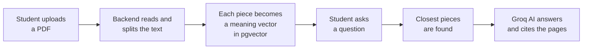

# StudyMate AI

**An AI study assistant that answers from your own PDFs, shows the page it used, and turns your notes into quizzes.**

[**Download APK**](https://github.com/sumaiya-akter-runa/StudyMate_AI/releases/latest) 

---

## The Problem

Before exams, students spend hours searching long PDFs and notes for one answer. General AI chatbots can explain things, but they answer without evidence, so it is hard to know when to trust them.

- Finding the right page in a long PDF takes too much time
- AI answers are not linked to the student's own study material
- There is no easy way to see which topics need more practice

## The Solution

StudyMate AI reads the student's own PDFs and answers only from them. Every answer shows the page it came from, so the student can check it in one tap. The app also builds quizzes from the same PDFs and tracks weak topics.

> **Answers come from your PDF, not from guesses.**
> The AI is told to treat PDF text as data and to say so when the answer is not in the document.

## How It Works

PDF processing runs in the background (Celery and Redis), so the app never freezes while a file is being prepared.

## Features

| Module | What it does |
|---|---|
| **AI Tutor** | Chat about any topic. Markdown answers with tables and code, copy, read aloud, regenerate and voice input |
| **Chat history** | Saved conversations that can be reopened or deleted |
| **PDF Q&A** | Ask questions about a PDF. Answers show page tags, and a tap shows the original text |
| **Summary** | Summary, key points with page tags and important terms. Saved and can be regenerated |
| **Quiz** | Multiple-choice quizzes from a PDF. Choose 5, 10 or 15 questions and easy, medium or hard |
| **Retry wrong answers** | Practice only the questions you missed. It never changes your stats |
| **Progress** | Overall score, recent scores, strong topics, weak topics and quiz history |
| **Practice weak topics** | A quiz built around your weak topics, taken from the PDF where you struggled most |
| **Account** | Register, login, edit name, change password, delete account, light and dark mode |

## Installation

1. Open the [latest release](https://github.com/sumaiya-akter-runa/StudyMate_AI/releases/latest) and download `app-release.apk`
2. Open it on an Android phone (allow *Install from unknown sources* if asked)
3. Register, upload a PDF and start asking questions

> The server runs on a free plan, so the first request after a quiet period can take up to a minute.

## Tech Stack

| Layer | Technology |
|---|---|
| Mobile app | Flutter, Dart |
| Backend | Django, Django REST Framework |
| Database | PostgreSQL with pgvector |
| Background jobs | Celery, Redis |
| AI | Groq API (Llama) for chat, quizzes and summaries. Gemini embeddings for PDF search |
| Deployment | Docker on Render |
| Security | JWT authentication, tokens in Android secure storage, each user sees only their own data, PDF file checks |

## Known Limitations

- Scanned PDFs (photos of pages) are not supported yet, only text PDFs
- For very long PDFs the summary is built from pieces spread across the document
- Android only
- The free server can be slow on the first request

## Future Work

- Flashcards from PDFs
- Study streak and reminders
- Bangla and English answer toggle
- Timed exam mode

## Author

**Sumaiya Akter Runa**
